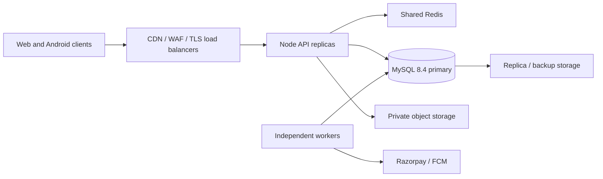

# Architecture and 100,000 simultaneous users

## Request path

MySQL is authoritative for customers, roles, sessions, stock, prices, bookings, payment events and job leases. Redis holds revocable session data, bounded public catalog caches, stampede locks and shared rate counters. API processes have no required local durable state; production uploads require shared object storage. Static files can be cached at the edge. Responses containing user data are `no-store`.

Checkout locks product rows in a consistent order and records the reservation, line snapshots and inventory ledger in one transaction. A unique `(user_id,idempotency_key)` constraint prevents duplicate checkout/booking requests. Amounts are integer paise. Payment capture locks its resource and compares provider order, amount, currency and state. Expired stock reservations are never fulfilled by a late capture; a refund is queued.

Partner selection uses indexed city/status/availability matching and category eligibility. Acceptance locks the booking and partner, so only one assignment wins. Administrative reassignment is validated and audited. Recipients see city and requirements; customer contact/address and attachments become available to the assigned professional.

Workers claim durable jobs with `FOR UPDATE SKIP LOCKED`, a lease token, bounded batches and exponential retries. Broadcast notifications are unique per campaign/user. Refund submissions reconcile known or uncertain gateway results before another action. Push delivery is at least once; clients should deduplicate `notificationId`. Device tokens are encrypted at rest and tied to revocable sessions.

## Capacity model

100,000 simultaneously active sessions differs from 100,000 requests per second. With 15–45 seconds between actions and one request per action, the midpoint is about **3,333 requests/second**; a page with multiple API requests, bursts, sign-in, uploads and checkout changes that demand. The requirement must be accepted against a measured workload, including peak writes and hot products, not a row count or an idle connection count.

Use the following as a **benchmark starting topology**, not a certified sizing recommendation or an order to purchase:

| Component | Initial benchmark arrangement | Measurement that governs resizing |
| --- | --- | --- |
| Edge | CDN/WAF and redundant TLS/load-balancing capacity | connection count, bandwidth, cache hit ratio, origin load |
| API | at least two replicas across independent hosts; add measured capacity | p95/p99, event-loop delay, CPU, RSS, request queue |
| MySQL | dedicated MySQL 8.4 primary, replica/backup, private access | transaction throughput, lock waits, pool waits, IOPS, replication lag |
| Redis | private shared service with a tested failover/backup strategy | operations/sec, latency, memory, evictions and reconnects |
| Workers | independent replicas with bounded concurrency | oldest job, retries, failed/reconciliation jobs, provider quotas |
| Storage | private S3-compatible bucket, signed uploads | upload latency, GET bandwidth, orphan objects and lifecycle |

The supplied Compose resource limits are small deployment examples, not 100,000-user sizing. APIs default to ten database connections and a queue of 100. Keep `replicas × DB_POOL_SIZE + workers + migration/admin headroom` below MySQL's tested connection budget. Do not allocate one MySQL connection per customer. Redis failure fails protected traffic closed; MySQL and Redis high availability are infrastructure work and are not provisioned by this repository.

Catalog search currently uses escaped substring matching with bounded pages and caching. It is appropriate for a nursery-sized catalog; evaluate full-text or a dedicated search index if catalog size/queries make scans material. Order and booking lists use indexed cursors and batch hydration. Administrative counters/reports are not customer request hot paths.

## Required acceptance run

1. Provision an isolated staging cluster equivalent to the intended production topology. Use synthetic data, a dedicated payment sandbox, separate Redis namespace and no live messaging recipients.
2. Seed realistic catalog/stock, at least 100,000 customer identities, distributed addresses, order/booking history and partner distribution. `scripts/seed-scale-fixture.mjs` is a guarded local database-row probe, not a concurrency test.
3. Run distributed generators outside the API hosts. `load-tests/k6.js` supplies a guarded public browsing profile and `load-tests/mixed.js` supplies authenticated read/write flows with externally provisioned synthetic sessions. Configure execution segments/shards so the aggregate is 100,000 VUs; a full profile on every generator multiplies the load. Size generators independently and confirm they are not the bottleneck.
4. Ramp 10%, 50%, 100%; hold the full target for at least 20 minutes, then a longer soak. Include sign-in bursts, predominantly browsing, own-account reads, cart updates, checkout/expiry, bookings, hot-product races, webhooks, and provider delays. The supplied profiles are starting fixtures; record the final traffic mix.
5. Suggested acceptance objectives to confirm with the business: <0.1% unexpected HTTP failures, origin p95 <250 ms and p99 <1 s for ordinary reads, bounded write latency, no duplicate capture/refund/assignment, no overselling or cross-user access, no unbounded queues, and sufficient capacity after loss of one API host. Exclude deliberate conflict/limit responses from unexpected failures only when the workload expects them.
6. Kill an API and a worker during transactions; test MySQL/Redis failover and dependency timeouts. Restore backups into a fresh environment. Reconcile payment sandbox totals and inventory before signing off.
7. Save generator manifests, exact image digest, hardware, topology, data volume, resource graphs, business invariant queries and latency/error distributions. Repeat after material code/infrastructure changes.

No distributed 100,000-VU run has been executed. The local verification record is deliberately limited to the checks actually performed.
